# viz3d

[](https://github.com/codepawl/viz3d/releases)
[](LICENSE)

Visualize anything in 3D. Give your agent a subject: a place, a system, an object, a product, a creature, a story or an
idea. The agent researches it, builds models to real dimensions, and makes a film, an app you click through, a lesson,
a book or a game. It checks its own frames before it shows you anything.

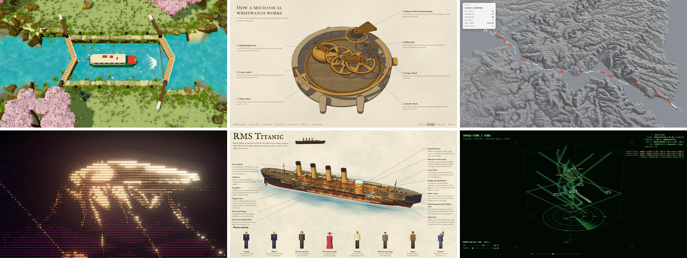

<table>
  <tr>
    <td width="200">
      <a href="https://67js.codepawl.com">
        <picture>
          <source media="(prefers-color-scheme: dark)" srcset="https://67js.codepawl.com/brand/wordmark-dark.svg?v=0.10.0" />
          
        </picture>
      </a>
    </td>
    <td>
      Films and stills render in <a href="https://github.com/codepawl/67.js"><b>67js</b></a>, our WebGL2 engine that
      agents drive through an MCP server: JSON scene recipes, PNG review grids, and GPU or CPU export to images and
      video with bounded memory. viz3d works without it, and looks better with it. See
      <a href="#films-and-stills-with-67js">Films and stills with 67js</a>.
    </td>
  </tr>
</table>

## Start in three steps

1. [Install](#install) the plugin.
2. Type `/viz3d` with nothing after it (`/visualize-in-3d:viz3d` in Claude Code with the plugin). The agent shows the menu of modes and looks.
3. Type a mode, a look if you want one, and the subject: `/viz3d film white model the Chernobyl accident`.

Put the subject in quotes when it starts with a mode or look word: `/viz3d "film noir city"`.

You can also skip the command and ask in your own words. The agent picks the mode and the look from the subject.

## What do you want to make?

| You want to | Type |
|---|---|
| Tell a story or an event as a film | `/viz3d film the 1906 San Francisco earthquake` |
| Show creatures, machines or characters in action | `/viz3d action two mechs fighting in a flooded city` |
| Show off one object, product or model | `/viz3d showcase glow a cockroach` |
| Show how a place or a system runs | `/viz3d app a container port` |
| Teach how a thing works, step by step | `/viz3d lesson an Arduino that fades an LED` |
| Open up one big object or building, room by room | `/viz3d book the Titanic` |
| Let people play it | `/viz3d game pixel a worm that eats its way through a city` |
| Show your leads something this week | `/viz3d prototype our warehouse, from last week's CSV export` |
| Put a live 3D view in your own dashboard | `/viz3d embed our fleet, the feed is at /api/fleet/events` |

## Modes

The nine modes fall into three groups, by what people do with the result.

**Watch it**

- **Documentary film** (`film`): a 2 to 4 minute film of an event, told in order. It is built from a sourced fact
  file, a map, block-built scenes and flat glowing figures. Captions are timed for reading, and the score changes with
  the story.
- **Action short** (`action`): creatures, machines or characters doing something, such as a fight, a chase or a
  launch. Every move is planned beat by beat, and every hit lands on a visible contact. The agent checks the frames for
  hidden or mistimed actions before it shows you the film.
- **Showcase** (`showcase`): a film or a set of stills that shows off one object, product or model. The model stays
  clean while the world around it turns to ASCII or glow.

**Explore it**

- **Live app** (`app`): a three.js app with a dashboard around a 3D world of the place. A seeded simulation moves the
  units and the numbers. The agent records a 30 s film by driving the app with real clicks on a virtual clock.
- **Lesson app** (`lesson`): a step-by-step lesson on a real object at real size, such as an Arduino and a
  breadboard. Parts and wires plug in as they do on a desk. The highlighted code line is what the board does right
  now. A free bench lets the learner build their own circuit.
- **Book** (`book`): a 3D illustrated cutaway plate of one big object or building, such as a liner or a castle.
  You orbit it, read the margin labels and fly into any room, each full of small people at work. Several subjects
  make a page-turning book with a short quiz on each page.
- **Game** (`game`): a free browser game people play. The player steers one creature or unit through an open world
  that pushes back. It grows by playing and starts again from a death card. Bots play it before you do, to balance it
  and to find stuck states.

**Put it in your product**

- **Quick prototype** (`prototype`): a live app in one pass from three.js primitives, with no Blender. Use it when you
  need something to show your leads this week.
- **Live embed** (`embed`): the 3D view as a web component (`<viz3d-world>`) or an iframe page. It goes into the
  dashboard or product you already have. It reads your real data through a field mapping file, from REST, Server-Sent
  Events, WebSocket or a CSV export. A new feed needs no code change. Tokens stay on your backend.

| Documentary film | Action short |
|---|---|
|  | 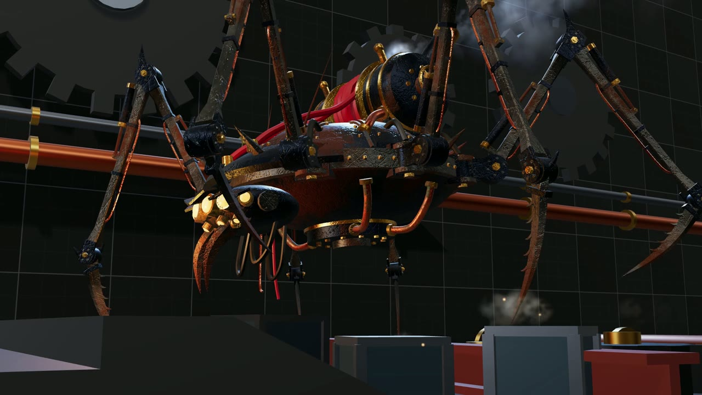 |
| **Showcase** | **Live app** |
|  |  |
| **Lesson app** | **Book** |
|  | 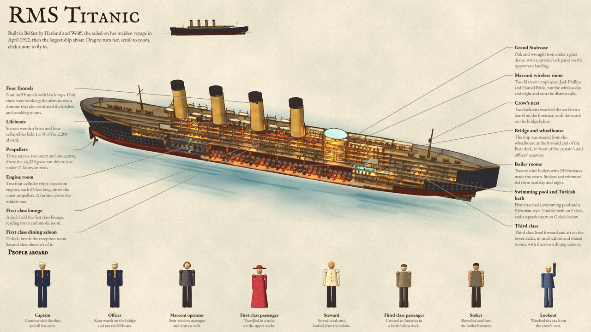 |
| **Game** | **Quick prototype** |
| 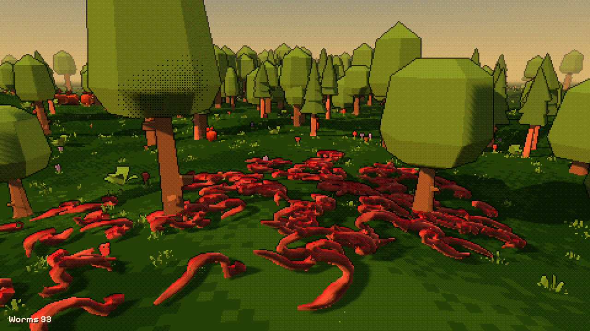 |  |
| **Live embed** | **Stage cameras in a live app** |
|  |  |

Every live app has stage cameras on number keys, a guided tour and a follow camera, as in the metro app above.
Playback runs from 0.25x to 10x.

## Looks

The thirteen looks fall into four families. Put the look word in your command, or leave it out and the agent uses the
default look for the mode.

| Family | Look | Word | Fits |
|---|---|---|---|
| Clean product | Clean ops world | `ops` | The default for a system that runs: a white-grey world with one accent colour, framed like a real operations product |
| | Toy isometric | `toy` | A friendly diorama of a place or system |
| | Lived-in isometric | `lived-in` | Ordinary buildings where people live or work and a crisis plays out inside |
| Real and cinematic | Photoreal terrain | `terrain` | Something spreading over real land, such as a wildfire or a flood |
| | Dark documentary | `documentary` | A case or an event told as a film |
| | White model documentary | `white model` | A case told as an architect's white model |
| | Layer build film | `layer build` | One locked aerial camera while a place is built up layer by layer |
| Technical | Point-cloud survey | `point cloud` | A scanned, technical view of land, sea or a site |
| | Illustrated cutaway plate | `plate` | One big object or building cut open, for the book mode |
| | Space-time cube | `space-time` | Movers under spacing rules, such as air traffic: the map is the floor, time goes up, and you drag a tube to fix a breach |
| Stylized art | Pixel diorama | `pixel` | Pixel-art sprites on a 3D stage, for battles, games and small worlds |
| | Dither + ASCII showcase | `ASCII` | A film that shows off a model, a tool or a product: the model stays clean, the world around it turns to ASCII |
| | Gradient glow ASCII | `glow` | A creature or object that is itself the art, drawn in glowing ASCII |

| Toy isometric | Illustrated cutaway plate |
|---|---|
| 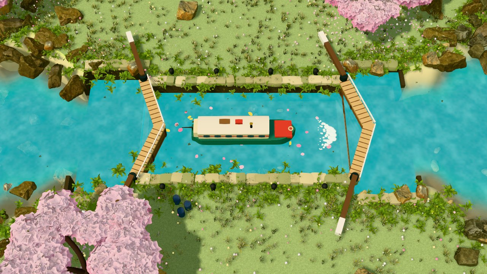 | 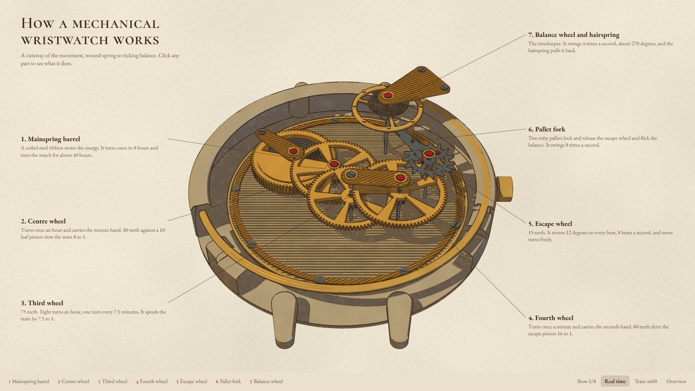 |
| **Point-cloud survey** | **Space-time cube** |
| 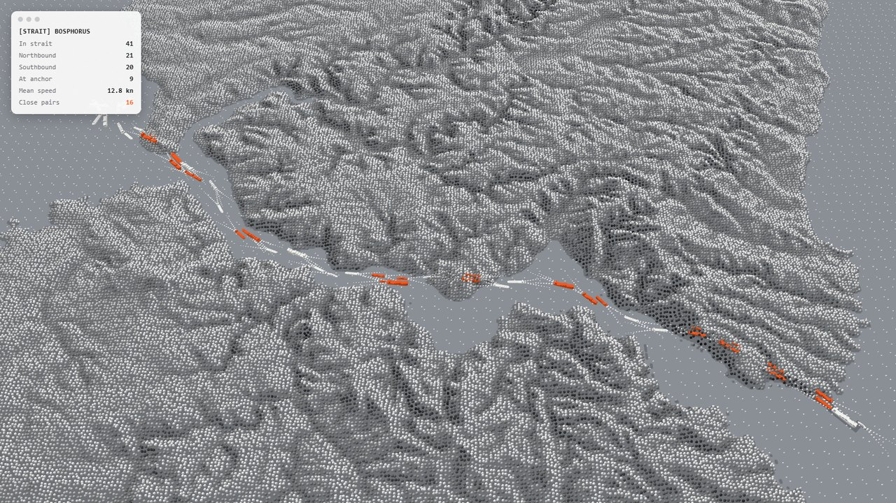 | 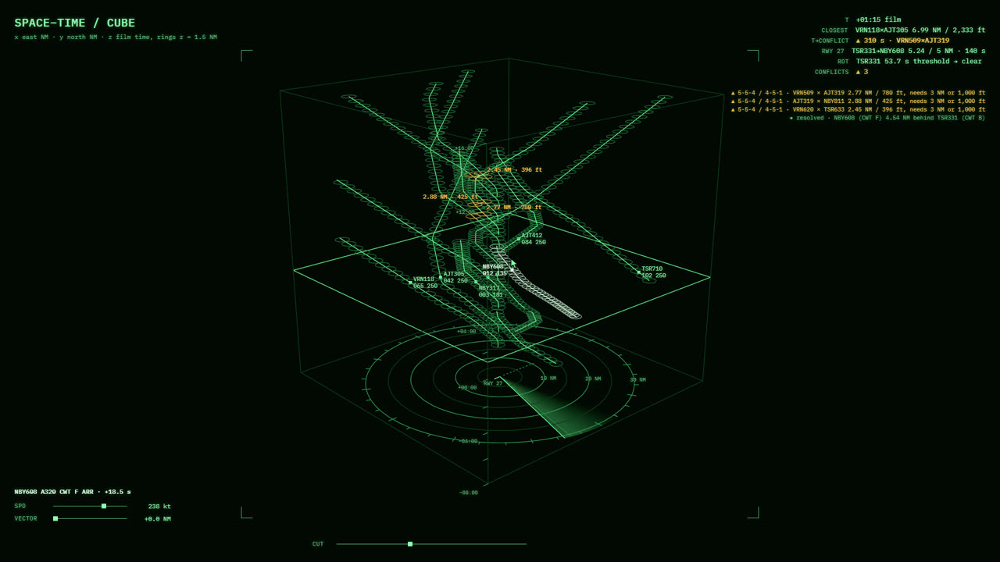 |
| **Layer build** | **ASCII** |
| 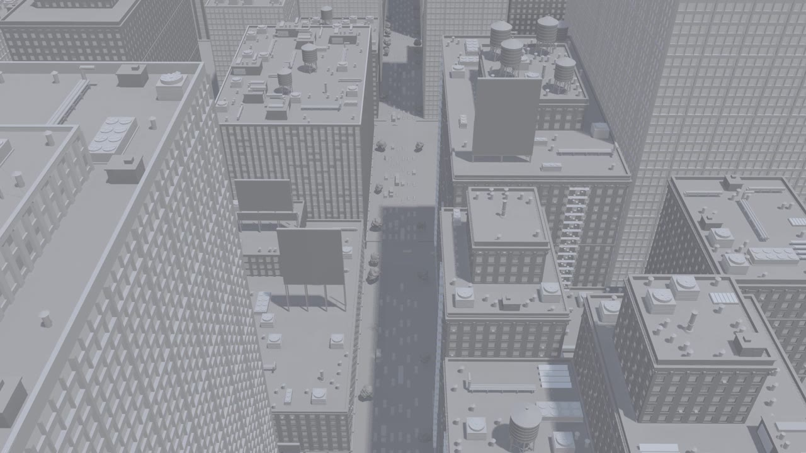 | 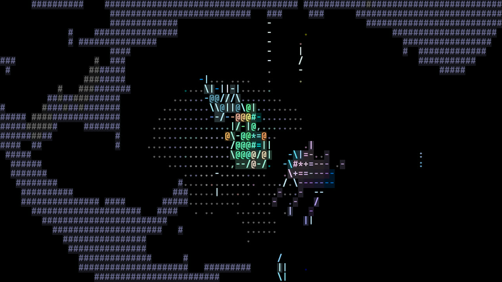 |

Default looks: apps, prototypes, embeds and lessons use clean ops world. Films use dark documentary, showcases use
Dither + ASCII and books use the cutaway plate. You can show the agent a reference video of a new look. It studies the
frames and writes the look up for next time.

## Real places

A real place starts from its real layout. The agent draws the plan from OpenStreetMap data and builds the 3D world on
the same coordinates, so the two line up. Things then work as they do in reality. Aircraft follow the taxiway centre
lines and give way to each other. Jet bridges and service vehicles attach to the real doors and ports, and the agent
measures every gap before it records.


## How the agent works

1. It writes a plan file: the real parts of the subject, what moves, the beats, the look and the camera.
2. It gets the models: ready models and scans first, then Blender builds from reference pictures.
3. It builds the app or the film from the plan file.
4. It checks its own frames on contact sheets for up to three rounds and fixes what it finds.
5. It sends you a fast low-quality preview of the whole film. The full render waits for your sign-off.

The skill asks before it downloads anything, such as elevation data, map data or reference images.

### It learns the style from a picture

The agent never builds a look from words alone. It finds a reference in the same look, writes a style card (camera,
palette, light, brightness, density, hero props) and checks every round against it with measured gates:

- `compare-look.py` compares brightness, saturation and hue with the reference and fails when the render drifts.
- `ground-share.py` fails a frame where one flat colour covers more than a quarter of it.
- The subject must fill at least a third of the default view.
- Grass, trees and props come from CC0 and CC BY packs, never from code-built blades or boxes.

Every correction you give becomes a dated rule in a lessons file, so the next build starts from it.

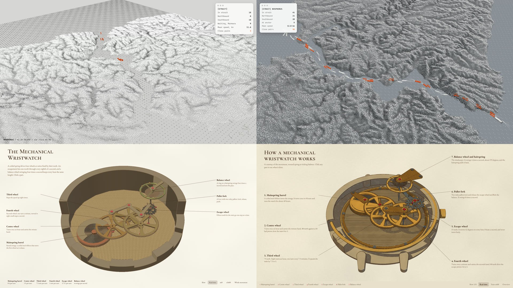

*Left: the first build. Right: the same subject after the agent applied its own review notes.*

## Install

In Claude Code, add this repository as a plugin marketplace and install the plugin:

```text
/plugin marketplace add codepawl/viz3d
/plugin install visualize-in-3d@codepawl
```

From a shell, the same two steps are:

```bash
claude plugin marketplace add codepawl/viz3d
claude plugin install visualize-in-3d@codepawl
```

For Claude Code, Codex, Cursor and other agents that read skill folders, use the [skills CLI](https://github.com/vercel-labs/skills):

```bash
npx skills add codepawl/viz3d
```

To install by hand, copy both folders in `plugins/visualize-in-3d/skills/` (`visualize-in-3d` and the `viz3d`
command) into your agent's skills folder:

| Agent | Skills folder |
|---|---|
| Claude Code | `~/.claude/skills/` |
| Codex | `~/.agents/skills/` |
| Cursor | `~/.cursor/skills/` (it also reads `~/.claude/skills/` and `~/.agents/skills/`) |
| Gemini CLI | `~/.gemini/skills/` |
| OpenCode | `~/.config/opencode/skills/` |

Gemini CLI and OpenCode take slash commands from their own folders. To get `/viz3d` there, also copy the command file:

| Agent | Copy | To |
|---|---|---|
| Gemini CLI | `harness/gemini/viz3d.toml` | `~/.gemini/commands/` |
| OpenCode | `harness/opencode/viz3d.md` | `~/.config/opencode/commands/` |

How you type the command depends on the agent:

| Agent | Command |
|---|---|
| Claude Code, plugin install | `/visualize-in-3d:viz3d` (Claude Code puts the plugin name in front of plugin commands) |
| Claude Code, skills folder | `/viz3d` |
| Codex | `$viz3d`, or pick it from `/skills` |
| Cursor | `/viz3d` |
| Gemini CLI, OpenCode | `/viz3d`, after you copy the command file |

## Live embed

For a live embed, the agent builds a web component and an iframe page. Put the component in any page and point it at
your feed:

```html
<script type="module" src="/viz3d-world.js"></script>
<viz3d-world source="https://ops.example.internal/events" mapping="/mapping.json" chrome="panel"></viz3d-world>
```

`mapping.json` links your field names and status codes to the 3D view, so a new feed needs no code change. For a tool
that only takes a URL, use `embed.html?source=...` in an iframe. To test without your real system, the skill's
`scripts/mock-feed.mjs` replays a JSONL file as a live feed.

## Films and stills with 67js

Apps, lessons, embeds and games stay in three.js, because people click and steer them. Documentaries, action shorts,
showcases, cutaway films and stills render in [67js](https://github.com/codepawl/67.js) when it is installed:

- Addons give terrain, scanned trees and grass, baked liquid, vehicles on paths and skinned characters. Others give
  HDRI light and baked room light.
- The agent builds the scene as a JSON recipe through MCP and checks it on labelled review grids. It tries two or
  three looks as branches and shows you the grid to pick from.
- A timeline of shots with fades and depth of field drives the clock. Any frame renders the same in any order.
- Render jobs export PNG and MP4 with the soundtrack and an audio sync check. Memory is planned before it is used.
- Films longer than one render job are split, joined and checked. A 70 s test film showed no jump or sound gap at the
  joins.

Set it up in your project:

```bash
npm install 67js@npm:@codepawlhq/67js
```

```bash
claude mcp add 67js-scene -- npx --package @codepawlhq/67js 67js-mcp --backend gpu --memory 256
```

```bash
npx skills add codepawl/67.js
```

The last command adds the 67js skills (`build-67js-scene` and `render-67js-media`). The skill's
`references/67js.md` has the full workflow, Windows notes and the faults we have seen. Showcase and docs are at
[67js.codepawl.com](https://67js.codepawl.com). If viz3d is useful to you, a star on
[codepawl/67.js](https://github.com/codepawl/67.js) helps the engine behind it.

## What you need

- Node 20 or later, with Playwright and Chromium for recording.
- ffmpeg on your PATH.
- A GPU that runs WebGL2 at 1080p.
- [Blender](https://www.blender.org/download/) 5.x is optional. It gives much better models for the full live app and
  the documentary. Without it the skill builds the models in three.js and tells you the quality is lower. Quick
  prototypes and embeds never need it.
- [67js](https://github.com/codepawl/67.js) is optional. It renders the films and stills, as described above.

## What is new

- Style from a reference: a style card in the plan file, checked by measured gates (`compare-look.py`,
  `ground-share.py`).
- Ground cover from real assets: a CC0 ground texture under instanced grass tufts.
- Machines in cutaway plates move at their real gear ratios on one clock, in round cases with real plate finishes.
- viz3d now covers any subject, not only things that are hard to understand.
- The `showcase` mode: a film or stills that show off one object, product or model.
- `/viz3d` with nothing after it shows the menu. The menu groups the modes by what people do with them and the looks by family.
- Films and stills render in [67js](https://github.com/codepawl/67.js) when it is installed.
- The `game` mode: a playable browser game, balanced by bot playtests.
- A longer self-review fault list. It checks contact and support, camera flights through meshes, vehicles that
  steer and roll, and sound.

## Also in this repository

**build-minecraft-model-from-image** turns a picture of an object into a Minecraft-style 3D model. The agent looks at
the picture and writes the model as code: a few cuboids with pixel textures. It does not use a fine voxel grid or an
image-to-3D network. You get a GLB, a viewer page, renders from every side and a sheet that compares them with the
picture. It needs Python through [uv](https://docs.astral.sh/uv/) and Blender 5.x for the renders.

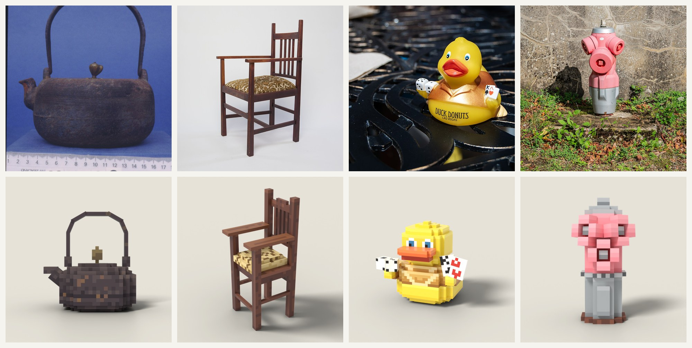

```text
/plugin install build-minecraft-model-from-image@codepawl
```

Photo credits for the picture above and the skill's `examples/`: kettle and armchair by Auckland War Memorial Museum
(armchair photo by Gerald E Jones), CC BY 4.0. Rubber duck by Julian Lupyan, CC0. Fire hydrant by Tournasol7, CC BY 4.0.
All from Wikimedia Commons.

**build-house-from-plan** turns a 2D house plan into a photoreal 3D house. The agent reads the walls, doors, windows and
scale off the drawing into a plan file. A check overlays the built walls on the drawing's ink and fails when they do not
line up. The house gets measured wall thickness, real frames and glass, CC0 scanned materials and real furniture models,
and renders in Blender Cycles. You get stills, a film of the walls rising off the drawing, and whole streets. It needs
Python through [uv](https://docs.astral.sh/uv/), Blender 5.x and a GPU.

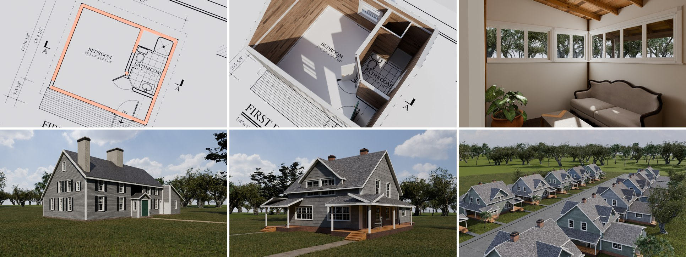

```text
/plugin install build-house-from-plan@codepawl
```

The plans behind the picture are public domain. They are Historic American Buildings Survey and Historic American
Engineering Record sheets from the Library of Congress, and a USDA plan. Furniture includes CC BY models listed in the skill's example.

**make-pixel-splats** makes pixel art scenes out of gaussian splats that a script writes, with no 3D model. Each
shape is a signed distance function. Every surface voxel becomes one round splat with sun, shadow and ambient light
baked into its colour. [67js](https://github.com/codepawl/67.js) draws the splats at a low size, then a post pass adds
glow, haze, a small palette and ordered dither. It comes with three haunted medieval scenes, three cozy islands, eased
motion helpers and a headless renderer for stills and films. It needs Node 20, Chrome and npm.

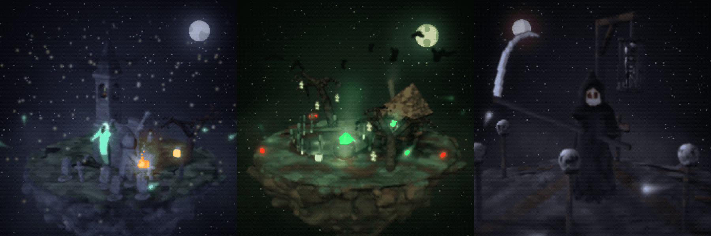

```text
/plugin install make-pixel-splats@codepawl
```

## Contributing

Faults you saw, new looks, example topics and harness adapters are welcome. Read
[CONTRIBUTING.md](CONTRIBUTING.md). Coding agents read [AGENTS.md](AGENTS.md).

## License

MIT
